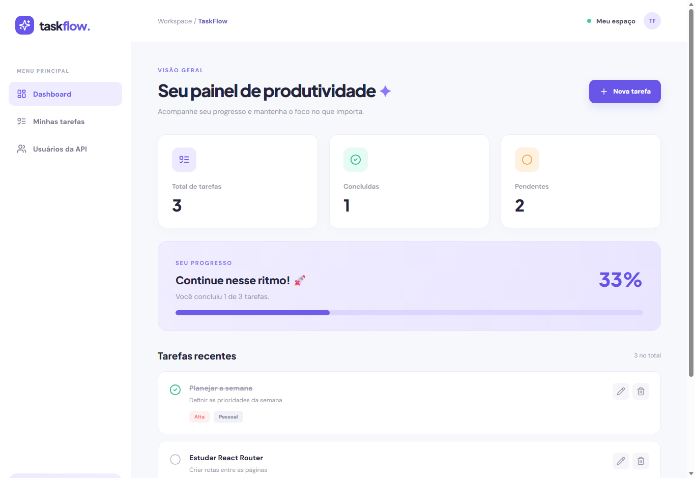

# ⚡ TaskFlow — Projeto React (Aula 08)

Gerenciador de tarefas responsivo construído com **React 19, Vite 7 e React Router 7**, aplicando na prática os fundamentos estudados na **Aula 08 (Projeto React)** — além de integração completa com estado, formulários, efeitos, API e rotas — na disciplina de **Frameworks Front-end** (SENAI).

- **Deploy em Produção (Vercel):** [🌐 Ver online](https://react-taskflow-tau.vercel.app)
- **Repositório GitHub:** [🔗 Repositório](https://github.com/Enzootomas/react-taskflow)

---

## 📸 Captura de Tela da Aplicação em Funcionamento



---

## 🎯 Descrição da Atividade

Desenvolver uma aplicação React aplicando os conceitos fundamentais de **JSX**, **Componentes**, **Props**, **Virtual DOM e Reconciliação**, **Listas e Keys** e **Renderização Condicional**, estruturando componentes desacoplados e reutilizáveis em repositório público documentado.

---

## 📚 Conceitos Aplicados no Projeto

| # | Conceito | Onde está implementado no projeto |
|---|---|---|
| 01 | **JSX** | Sintaxe declarativa e interpolação `{}` em `App.jsx`, `Sidebar.jsx`, `TaskCard.jsx` e `TaskForm.jsx` |
| 02 | **Componentes** | Divisão modular em `Sidebar`, `StatCard`, `TaskCard`, `TaskForm`, `Dashboard`, `TasksPage`, `TaskDetailPage` e `UsersPage` |
| 03 | **Props** | Passagem unidirecional de dados e callbacks pai → filho (`task`, `onToggle`, `onEdit`, `onDelete`, `initial`, `onSave`) |
| 04 | **Virtual DOM** | Reconciliação declarativa da interface pelo React quando `tasks`, `query` ou `filter` mudam, sem manipulação manual do DOM |
| 05 | **Listas e Keys** | Transformação de coleções com `map()` e `filter()` utilizando chaves estáveis `key={task.id}` e `key={user.id}` |
| 06 | **Renderização Condicional** | Exibição condicional para listas vazias, carregamento (`loading`), erro (`error`), modal (`showForm`) e validação |
| 07 | **State, Formulários, `useEffect`, API e Rotas** | Persistência em `localStorage`, formulário controlado validado, consulta à API JSONPlaceholder e rota dinâmica `/tarefas/:id` (`useParams`) |

---

## ✨ Funcionalidades Implementadas

- Criar, editar, concluir/reabrir e excluir tarefas;
- Visualizar detalhes individuais de uma tarefa em rota dinâmica (`/tarefas/:id`);
- Filtrar tarefas por status (*Todas*, *Pendentes*, *Concluídas*) e pesquisar por texto em tempo real;
- Acompanhar estatísticas e barra de progresso percentual no Dashboard;
- Persistir tarefas automaticamente no navegador via `localStorage`;
- Consultar usuários externos da API pública [JSONPlaceholder](https://jsonplaceholder.typicode.com/users) com tratamento de carregamento e erro;
- Navegação SPA configurada para publicação na Vercel (`vercel.json`).

---

## 🛠️ Tecnologias Utilizadas

- React 19
- Vite 7
- React Router DOM 7
- Lucide React (Ícones)
- CSS3 Responsivo

---

## 📁 Estrutura de Diretórios

```text
react-taskflow/
├── docs/
│   └── screenshot-taskflow.png
├── src/
│   ├── components/
│   │   ├── Sidebar.jsx
│   │   ├── TaskCard.jsx
│   │   └── TaskForm.jsx
│   ├── App.jsx
│   ├── main.jsx
│   └── styles.css
├── index.html
├── package.json
├── vercel.json
└── README.md
```

---

## 🚀 Instruções de Instalação e Execução

Pré-requisitos: **Node.js 20.19+** (ou **22.12+**) e **NPM**.

```bash
git clone https://github.com/Enzootomas/react-taskflow.git
cd react-taskflow
npm install
npm run dev
```

Para gerar o build otimizado de produção:

```bash
npm run build
```

---

## 🔗 Repositórios Relacionados

- **Repositório Oficial:** [https://github.com/Enzootomas/react-taskflow](https://github.com/Enzootomas/react-taskflow)
- **Central de Estudos:** [https://github.com/Enzootomas/frontend-learning-hub](https://github.com/Enzootomas/frontend-learning-hub)

---

## 🎓 Disciplina

**Frameworks Front-end** — Curso Superior de Tecnologia em Análise e Desenvolvimento de Sistemas (SENAI)  
**Professor:** Me. Deivison S. Takatu
